# Manual de Usuario — FAFI 1.6

**Team T Studio** · versión 2.0.0 · noviembre de 2026
Instagram: **@teamtstudio**

> Este manual explica, paso a paso y sin términos técnicos, cómo jugar a FAFI 1.6. Todas las capturas son del juego real.

---

## Índice

1. [Qué es FAFI 1.6](#1-qué-es-fafi-16)
2. [Qué necesitás para jugar](#2-qué-necesitás-para-jugar)
3. [Cómo abrir el juego](#3-cómo-abrir-el-juego)
4. [Cuenta: registrarse, entrar o jugar sin conexión](#4-cuenta-registrarse-entrar-o-jugar-sin-conexión)
5. [El menú principal](#5-el-menú-principal)
6. [Modos de juego](#6-modos-de-juego)
7. [Controles](#7-controles)
8. [Armas y granadas](#8-armas-y-granadas)
9. [Tienda y cajas](#9-tienda-y-cajas)
10. [Equipamiento (tu inventario)](#10-equipamiento-tu-inventario)
11. [Perfil, amigos y logros](#11-perfil-amigos-y-logros)
12. [Ajustes](#12-ajustes)
13. [Consejos para jugar mejor](#13-consejos-para-jugar-mejor)
14. [Problemas frecuentes](#14-problemas-frecuentes)
15. [Preguntas frecuentes](#15-preguntas-frecuentes)
16. [Créditos y contacto](#16-créditos-y-contacto)

---

## 1. Qué es FAFI 1.6

FAFI 1.6 es un juego de disparos en primera persona por equipos, inspirado en Counter-Strike, que **se juega directamente en el navegador**: no hay que descargar ni instalar nada. Incluye:

- **Defuse 5 contra 5** contra bots, con economía, tienda y una bomba que plantar o desactivar.
- **Campo de tiro** para entrenar la puntería.
- **Mapa libre** para recorrer Dust II, Italy y Office sin reglas.
- **Modo historia** con una cinemática narrada del desembarco de Normandía.
- **Skins y cajas**: 37 diseños para el AK-47, el M4A4, el AWP, la Desert Eagle y el cuchillo.

---

## 2. Qué necesitás para jugar

| Requisito | Detalle |
|---|---|
| Navegador | Chrome, Edge o Firefox actualizados (con WebGL activado). |
| Computadora | Funciona en equipos de pocos recursos: alcanzan **4 GB de memoria** y un procesador doméstico. |
| Periféricos | Teclado y mouse. |
| Internet | Solo para abrir la página. Después se puede jugar **sin conexión**. |

El juego elige solo la calidad gráfica según tu equipo. Más adelante podés cambiarla en *Ajustes*.

---

## 3. Cómo abrir el juego

- **Desde el servidor del equipo:** entrá a la dirección web que te indiquen (por ejemplo `http://<IP del servidor>/`).
- **En tu propia computadora:** serví la carpeta `game-client` con cualquier servidor web estático y abrí `http://localhost:5173`. Abrir `index.html` con doble clic **no** funciona, porque el navegador bloquea los modelos 3D.

La primera vez puede tardar unos segundos mientras se cargan los modelos y los sonidos.

---

## 4. Cuenta: registrarse, entrar o jugar sin conexión

### Iniciar sesión

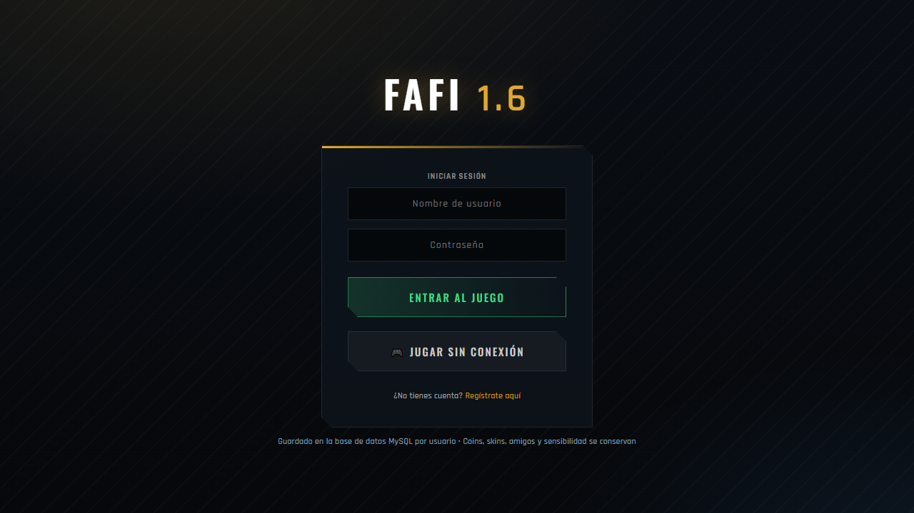

Escribí tu **nombre de usuario** y tu **contraseña** y apretá **ENTRAR AL JUEGO**.

### Crear una cuenta

Tocá **Regístrate aquí**. Elegí un usuario, escribí tu email y una contraseña, y apretá **CREAR CUENTA**.

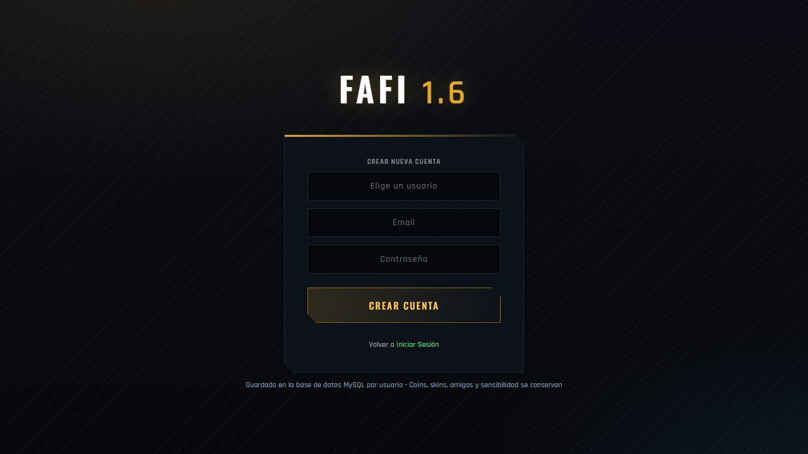

Con cuenta, el servidor guarda tus monedas, skins, amigos, logros y sensibilidad, y los recuperás desde cualquier computadora.

### Jugar sin conexión

Si no tenés cuenta o no hay servidor, escribí un nombre de usuario (mínimo 3 letras) y apretá **JUGAR SIN CONEXIÓN**. Tu progreso se guarda **solo en esa computadora y ese navegador**.

---

## 5. El menú principal

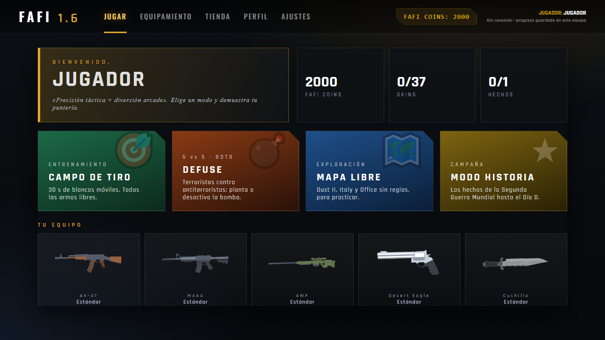

Arriba hay cinco pestañas:

| Pestaña | Para qué sirve |
|---|---|
| **Jugar** | Elegir el modo de juego. |
| **Equipamiento** | Ver y equipar tus armas y skins. |
| **Tienda** | Comprar y abrir cajas. |
| **Perfil** | Historial de compras, amigos y logros. |
| **Ajustes** | Sensibilidad, calidad gráfica y cerrar sesión. |

A la derecha ves tus **Fafi Coins** (la moneda del juego) y tu nombre. En la pestaña *Jugar* aparecen tus monedas, cuántas skins tenés (por ejemplo 0/37), los hechos de historia completados y el equipo que llevás.

---

## 6. Modos de juego

### 6.1. Campo de tiro (entrenamiento)

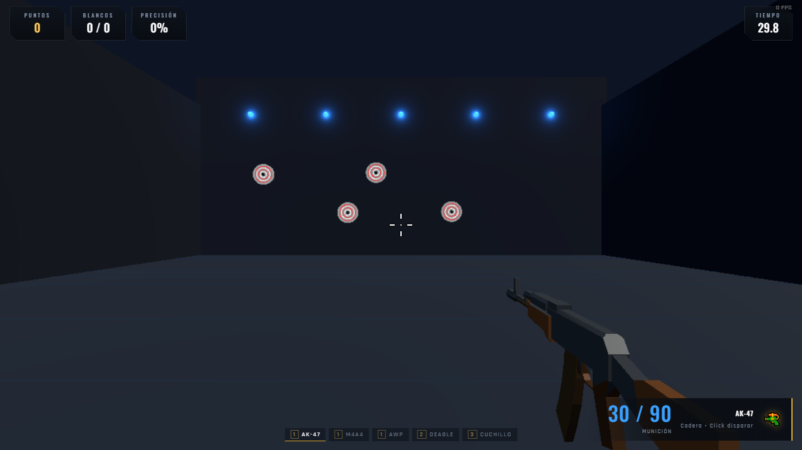

Tenés **30 segundos** para disparar a blancos móviles. Arriba ves tus **puntos**, los **blancos** acertados y tu **precisión**. En este modo podés usar todas las armas. Superar los 1000 puntos desbloquea el logro *Aim Pro*, y al terminar ganás 1 Fafi Coin cada 10 puntos.

### 6.2. Defuse 5 contra 5

Elegí el **mapa** (Dust II, Italy u Office) y tu **bando**:

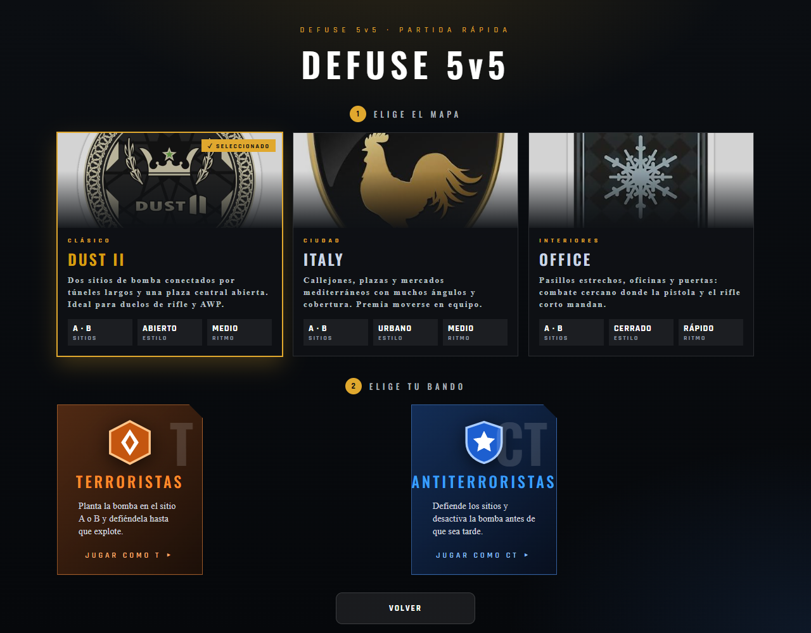

- **Terroristas (T):** plantan la bomba en el sitio **A** o **B** y la defienden hasta que explote.
- **Antiterroristas (CT):** impiden que la planten o la desactivan antes de que explote.

**Reglas de la partida:**

- Cada ronda dura **1:45** y empieza con **10 segundos de compra**.
- La bomba tarda **40 segundos** en explotar. Se planta o se desactiva **manteniendo apretada la tecla `E`**.
- Empezás con **$800** y ganás dinero por ganar rondas y por cada baja.
- Gana el primer equipo que llega a **4 rondas**.
- Tu equipo tiene 5 jugadores: vos y 4 bots. Los bots compran armas, hablan entre sí, te persiguen y también juegan la bomba.

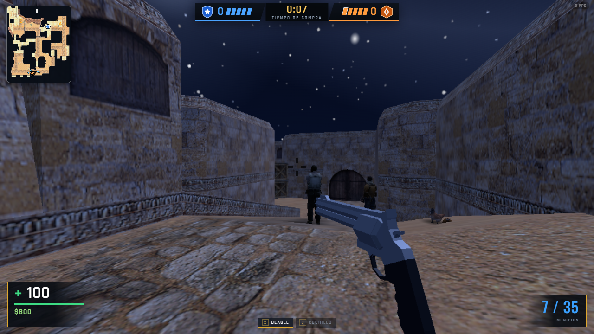

**La tienda de la partida (tecla `B`)** solo se abre en tu zona de aparición durante el tiempo de compra. Tiene pistolas, subfusiles, escopetas, rifles, francotiradores, chaleco, casco y utilidades.

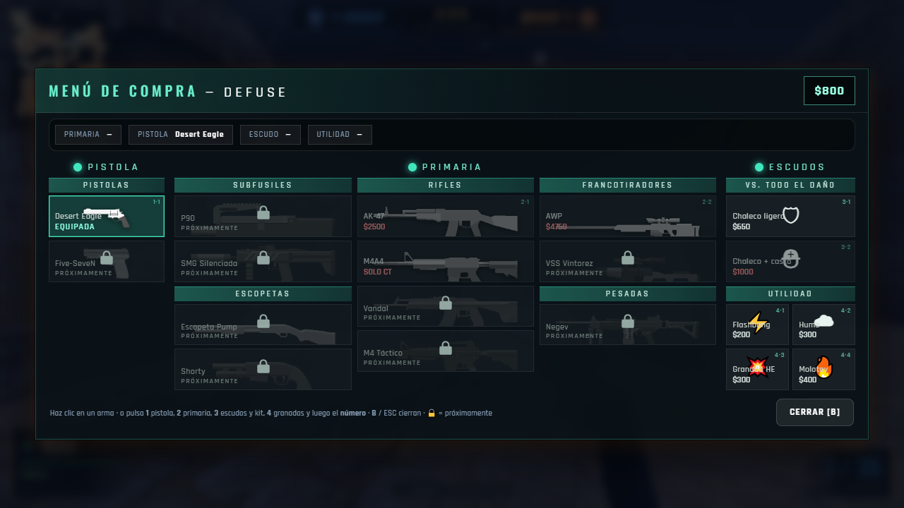

- En Defuse llevás **una pistola y un arma principal**: comprar otra del mismo tipo reemplaza la anterior.
- El **chaleco** ($650) absorbe parte del daño; con **casco** ($1000) también protege la cabeza.

**El marcador (tecla `Tab`)** muestra bajas, muertes, disparos a la cabeza, daño por ronda y dinero de todos los jugadores:

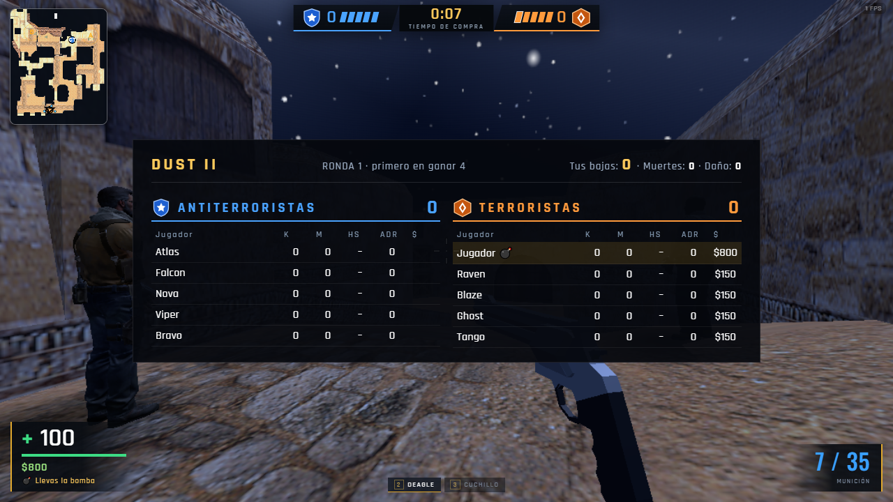

Con cuenta, al terminar la partida se guardan tus resultados en el ranking.

### 6.3. Mapa libre

Elegí Dust II, Italy u Office y recorrelos **sin reglas**, con dinero infinito en la tienda (`B`), para practicar armas y recorridos. Dust II, Italy y Office tienen ambientación nocturna.

### 6.4. Modo historia

Es una campaña educativa sobre la Segunda Guerra Mundial. Se ve un mapa de Europa con **7 hechos**; por ahora está disponible el primero y los demás se desbloquean a medida que se completan.

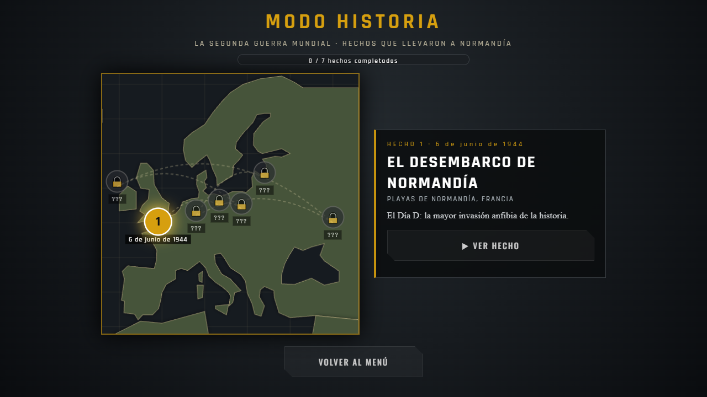

Tocá **VER HECHO** para ver **«El desembarco de Normandía»** (6 de junio de 1944): una cinemática en 3D narrada con voz, con lanchas, aviones y búnkeres.

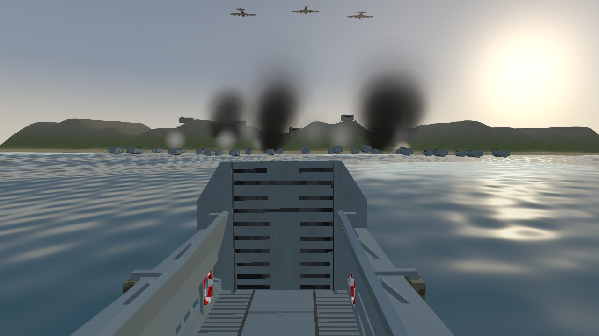

Podés saltar la cinemática con la tecla `Esc` o el botón de saltar. Al terminarla, el hecho queda marcado como completado.

---

## 7. Controles

| Acción | Tecla |
|---|---|
| Moverse | `W` `A` `S` `D` |
| Saltar | `Espacio` |
| Agacharse | `Shift` |
| Disparar | Clic izquierdo |
| Apuntar / mirilla | Clic derecho |
| Recargar | `R` |
| Inspeccionar el arma | `F` |
| Cambiar de arma (siguiente) | `Q` |
| Arma primaria | `1` |
| Arma secundaria | `2` |
| Cuchillo | `3` |
| Granadas: aturdidora / humo / explosiva / incendiaria | `4` / `5` / `6` / `7` |
| Abrir la tienda de la partida | `B` |
| Plantar o desactivar la bomba | `E` (mantener) |
| Ver el marcador | `Tab` |
| Pausa / volver al menú | `Esc` |

**Mouse:** al empezar una partida el navegador captura el mouse; tocá la pantalla para activarlo. Para soltarlo, apretá `Esc`.

---

## 8. Armas y granadas

| Arma | Tipo | Detalles |
|---|---|---|
| **AK-47** | Rifle (T) | Gran daño, retroceso marcado. |
| **M4A4** | Rifle (CT) | Más estable, ideal a media distancia. |
| **AWP** | Francotirador | Un disparo muy fuerte. Tiene **zoom doble** (clic derecho), cerrojo entre disparos y mira de francotirador. |
| **Desert Eagle** | Pistola | Potente y precisa. |
| **Cuchillo** | Cuerpo a cuerpo | Siempre disponible. |
| **Granadas** | Utilidad | Aturdidora (ciega), de humo, explosiva e incendiaria. |

**Cómo funciona el disparo:**

- El cuerpo del enemigo tiene varias zonas: un **disparo a la cabeza** hace mucho más daño.
- Cada arma tiene su propio **patrón de retroceso**, y la mira se abre cuando te movés o disparás.
- Los chalecos y cascos reducen el daño que recibís.

---

## 9. Tienda y cajas

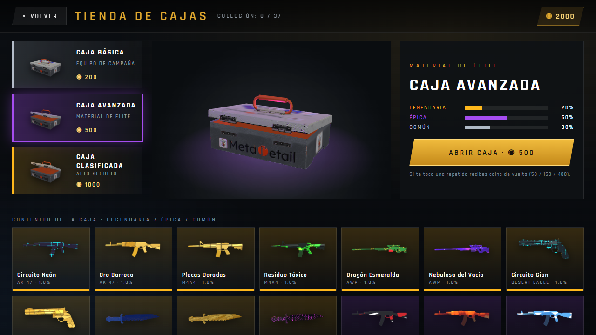

En la pestaña **Tienda** abrís cajas con tus Fafi Coins. Cada caja tiene una probabilidad distinta de dar skins comunes, épicas o legendarias:

| Caja | Precio | Común | Épica | Legendaria |
|---|---|---|---|---|
| **Caja Básica** | 200 | 85 % | 15 % | — |
| **Caja Avanzada** | 500 | 30 % | 50 % | 20 % |
| **Caja Clasificada** | 1000 | — | 50 % | 50 % |

Elegí una caja a la izquierda, mirá su contenido abajo y apretá **ABRIR CAJA**. Se reproduce una animación: la caja cae, vibra, salta la tapa y sale flotando el arma que ganaste, con el color de su rareza. Podés saltarla con el botón *SALTAR*.

Si te toca una **skin repetida**, recibís monedas de vuelta: **50** (común), **150** (épica) o **400** (legendaria). Con cuenta, la compra y el sorteo los hace el servidor y tu inventario queda guardado.

**Cómo conseguir monedas:** en el campo de tiro ganás **1 moneda cada 10 puntos** al terminar los 30 segundos. Las skins repetidas también te devuelven monedas.

---

## 10. Equipamiento (tu inventario)

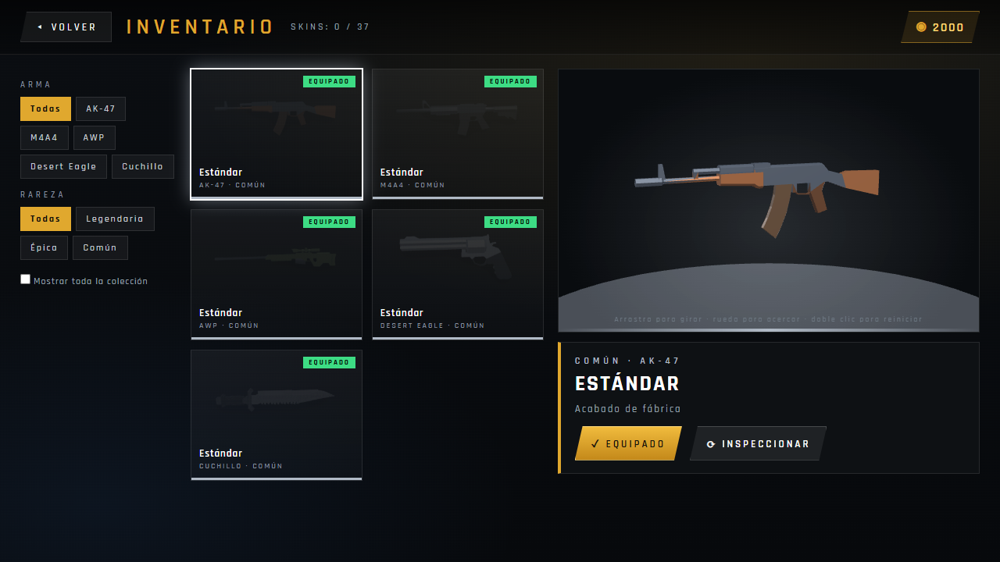

- A la izquierda filtrás por **arma** y por **rareza**.
- Al elegir una skin, a la derecha se muestra el arma en 3D: **arrastrá para girarla**, usá la **rueda para acercar** y **doble clic para reiniciar**.
- Apretá **EQUIPAR** para usarla en las partidas, o **INSPECCIONAR** para verla de cerca.
- Marcá *Mostrar toda la colección* para ver también las skins que todavía no tenés.

Cada arma empieza con su versión **Estándar**.

---

## 11. Perfil, amigos y logros

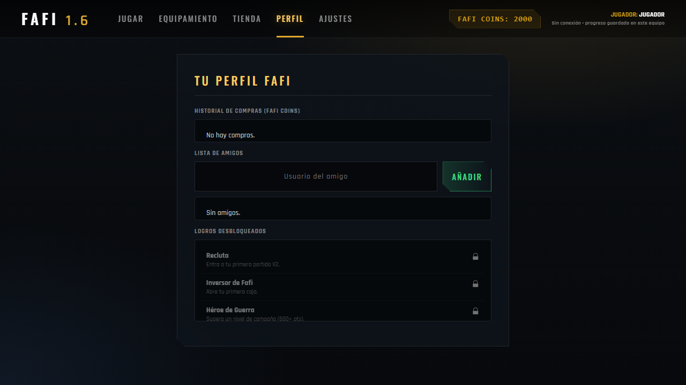

- **Historial de compras:** las cajas que abriste y lo que gastaste.
- **Amigos:** escribí el usuario de un amigo y apretá **AÑADIR** (requiere cuenta).
- **Logros:**

| Logro | Cómo se consigue |
|---|---|
| **Recluta** | Entrar a tu primera partida. |
| **Inversor de Fafi** | Abrir tu primera caja. |
| **Héroe de Guerra** | Superar un nivel de campaña. |
| **Explorador Dust2** | Entrar a Dust II por primera vez. |
| **Aim Pro** | Conseguir más de 1000 puntos en el campo de tiro. |

---

## 12. Ajustes

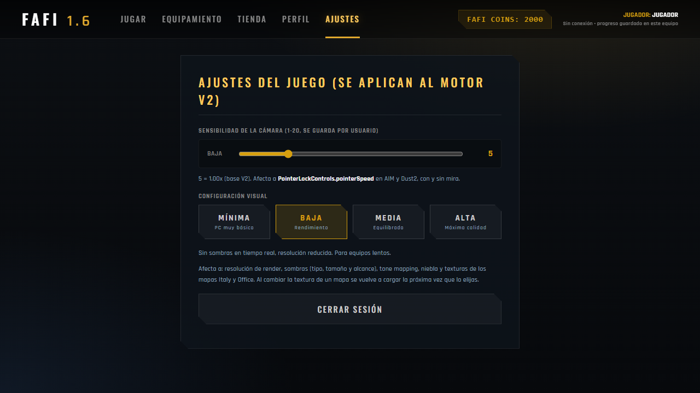

- **Sensibilidad de la cámara (1 a 20):** cuánto gira la vista con el mouse. Se guarda por usuario.
- **Calidad gráfica:** *Mínima* (PC muy básica), *Baja* (rendimiento), *Media* (equilibrado) o *Alta* (máxima calidad). Cambia la resolución, las sombras, la niebla y las texturas. Si el juego va lento, bajala.
- **Cerrar sesión.**

---

## 13. Consejos para jugar mejor

1. Empezá en el **campo de tiro** para acostumbrarte al retroceso de cada arma.
2. **Apuntá a la cabeza**: mata mucho más rápido.
3. En Defuse, **comprá chaleco** antes que una arma cara cuando tengas poco dinero.
4. **Escuchá**: los pasos y los disparos suenan con dirección y se oyen más bajo cuando están lejos.
5. Usá las **granadas de humo** para cruzar zonas abiertas y las **aturdidoras** antes de entrar a un sitio.
6. Recorré los mapas en **Mapa libre** para aprender los caminos hacia los sitios A y B.
7. Si el juego va lento, bajá la **calidad gráfica**.

---

## 14. Problemas frecuentes

**No puedo iniciar sesión.** Revisá usuario y contraseña. Si el servidor no responde, usá **Jugar sin conexión**.

**La página queda en negro o no carga.** Esperá unos segundos (los modelos pesan). Actualizá la página con `F5`. Comprobá que tu navegador tenga WebGL activado y esté actualizado.

**El mouse no mueve la cámara.** Hacé clic dentro del juego para que el navegador capture el mouse. Si lo soltaste con `Esc`, volvé a hacer clic.

**Va lento o se traba.** Bajá la calidad en *Ajustes*, cerrá otras pestañas y programas, y usá Chrome o Edge.

**No se escuchan los sonidos.** El navegador activa el audio con el primer clic o tecla. Revisá el volumen de la computadora.

**Perdí mi progreso.** Sin cuenta, el progreso vive en ese navegador: si borrás los datos del sitio, se pierde. Con cuenta se conserva en el servidor.

**Un archivo de sonido o modelo no aparece.** Probá actualizar con `Ctrl + F5`.

---

## 15. Preguntas frecuentes

**¿Cuesta algo jugar?** No. Es gratis y no hay que instalar nada.

**¿Puedo jugar sin internet?** Sí, una vez cargada la página, con *Jugar sin conexión*.

**¿Hay multijugador online?** Hoy se juega contra bots. El servidor ya incluye el canal para partidas en línea, que se sumará en próximas versiones.

**¿Funciona en celular?** No está pensado para celulares: necesita teclado y mouse.

**¿Cuántas skins hay?** 37 disponibles, y otras 45 preparadas para armas que se van a habilitar más adelante.

**¿Para qué sirven los hechos del modo historia?** Son capítulos educativos sobre la Segunda Guerra Mundial. El primero cuenta el desembarco de Normandía; los demás se irán sumando.

---

## 16. Créditos y contacto

**Team T Studio**: Santino Laudati, Dante Iglesias e Ian Quiroga.
EEST N°1 «Eduardo Ader» · Vicente López · Laboratorio de Programación 5°3.

Los modelos, sonidos y fotografías de terceros están listados con sus autores y licencias en `CREDITS_2_0_0v.md`.

Seguinos en Instagram: **@teamtstudio**
Código del proyecto: <https://github.com/SantinoLaudati/Fafi-1.6>
